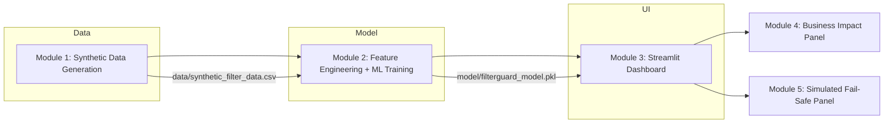
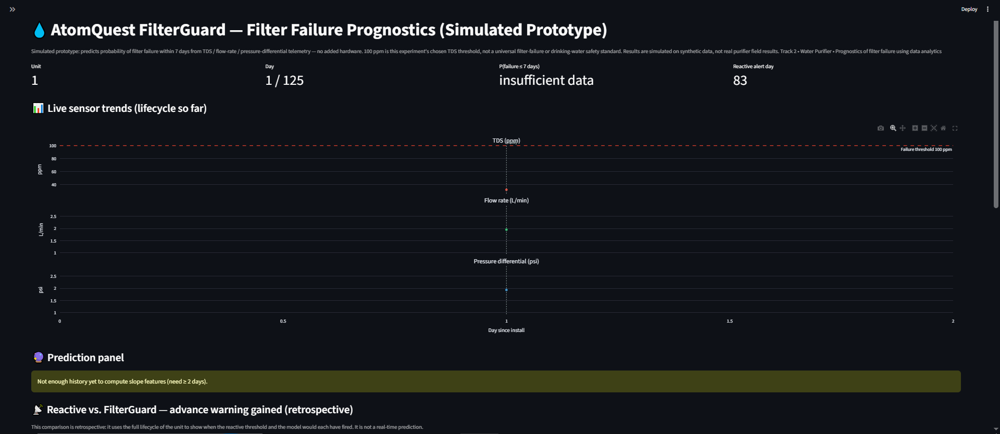
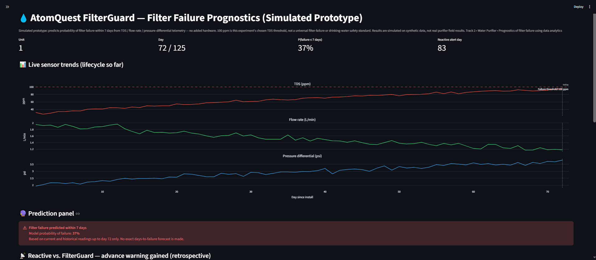
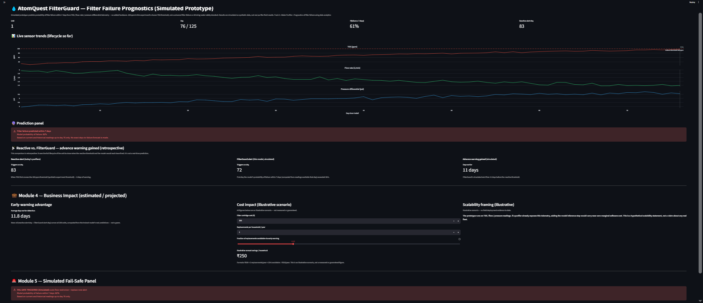

# FilterGuard

**Turning purifier sensor trends into early filter-failure risk intelligence.**

FilterGuard is a simulated software-only prototype that estimates the **probability of water-purifier filter failure within seven days** using only the purifier's existing TDS, flow-rate, and pressure-differential telemetry — no added hardware, no GPU, no cloud, and no paid APIs.

**All data is synthetic.** The system was trained and evaluated on 200 virtual purifier units (120–180 day lifecycles each). No real purifier hardware or field data was used. Results should be interpreted as simulated, not real-world performance.

[](https://www.python.org/)
[](https://scikit-learn.org/)
[](https://streamlit.io/)
[](https://github.com/anshchaudhary289-prog/atomquest-filterguard/tree/main/tests/)

---

## Table of Contents

1. [Problem](#problem)
2. [Solution](#solution)
3. [System Architecture](#system-architecture)
4. [Machine-Learning Approach](#machine-learning-approach)
5. [Evaluation Results](#evaluation-results)
6. [Dashboard Features](#dashboard-features)
7. [Repository Structure](#repository-structure)
8. [Setup and Installation](#setup-and-installation)
9. [Reproducibility and Testing](#reproducibility-and-testing)
10. [Limitations](#limitations)
11. [Future Scope](#future-scope)
12. [Team and Competition](#team-and-competition)

---

## Problem

Current household water purifiers alert the user only **after** the filter has already failed — when the TDS (Total Dissolved Solids) reading crosses a failure threshold. This gives **zero days of warning**, forcing premature or emergency cartridge replacement and leaving users without safe drinking water during the failure period.

The core operational problem is reactive rather than predictive: today's purifiers cannot estimate the *risk* of imminent failure from the sensor trends they already collect.

## Solution

FilterGuard addresses this by treating filter failure as a binary prediction problem: given the current and historical TDS, flow-rate, and pressure-differential readings, what is the probability that the filter will fail within the next seven days?

The system does **not** predict an exact number of days until failure. Instead, it outputs a **predicted probability of failure** within a seven-day window, giving users actionable advance warning to plan cartridge replacement before failure occurs.

---

## System Architecture

The pipeline consists of five modules, built and verified in order:



**Module 1 — Data Generation** (`data/generate_synthetic_data.py`)
Simulates 200 virtual purifier units, each over a 120–180 day filter lifecycle. Each unit's TDS degrades upward on an **exponential curve** toward a ~150 ppm ceiling, flow rate declines as the filter clogs, and pressure rises as flow declines. Gaussian noise is added to each sensor reading. Each unit's degradation rate is randomized ±20% so curves are not identical.

**Module 2 — Model Training** (`model/train_model.py`)
Engineers trailing 5-day slope features plus current readings and filter age. Trains and compares three models on a unit-level 64/16/20 train/validation/test split. Selects the classification threshold on the validation set only. Saves the trained model and metrics.

**Module 3 — Dashboard** (`app/dashboard.py`)
Streamlit demo interface with unit selection, **simulated** sensor trend charts (played back from the generated CSV, not live telemetry), failure-risk probability, playback controls, and a retrospective comparison banner.

**Module 4 — Business Impact Panel** (in `app/dashboard.py`)
Illustrative scenario calculations for early-warning advantage and projected cost savings, clearly labeled as illustrative.

**Module 5 — Simulated Fail-Safe Panel** (in `app/dashboard.py`)
When the model's failure probability exceeds the threshold, displays a simulated fail-safe alert with an explicit disclaimer that physical actuation is future work.

---

## Machine-Learning Approach

### Dataset Generation

- **Units:** 200 virtual purifier units
- **Lifecycle:** 120–180 days per unit (randomized)
- **Sensors:** TDS (ppm), flow rate (L/min), pressure differential (psi)
- **Noise:** Gaussian noise added to each reading (σ ≈ 2 ppm TDS, σ ≈ 0.05 L/min flow, σ ≈ 0.1 psi pressure)
- **Degradation:** Each unit's rate randomized ±20% for curve variety
- **Failure threshold:** 100 ppm TDS (synthetic experiment threshold, not a universal standard)
- **Output:** ~30,000 total rows across all units

### Features

All features are computed from current and historical readings only — no future information is used:

| Feature | Description |
|---|---|
| `tds_slope_5d` | Linear regression slope of TDS over trailing 5 days |
| `flow_slope_5d` | Linear regression slope of flow rate over trailing 5 days |
| `pressure_slope_5d` | Linear regression slope of pressure over trailing 5 days |
| `tds_ppm` | Current TDS reading |
| `flow_rate_lpm` | Current flow rate reading |
| `pressure_diff_psi` | Current pressure differential reading |
| `day` | Filter age in days since install |

### Target

- `failed_within_7d` = 1 when `0 <= days_to_failure <= 7` (failure day plus the 7 days before it)
- Post-failure days (`days_to_failure < 0`) are **not** labeled as positives
- Days outside the 7-day warning window (`days_to_failure > 7`) are **not** labeled as positives

### Train/Validation/Test Split

The data is split **by purifier unit**, not by individual rows, to prevent any unit's data from appearing in more than one split:

| Split | Units | Rows | Purpose |
|---|---|---|---|
| Train | 128 | 19,256 | Model fitting |
| Validation | 32 | 4,848 | Threshold selection |
| Test | 40 | 6,031 | Final evaluation |

Split is stratified by unit-level positive-rate quartile.

### Models Compared

Three models were trained and compared on the validation set:

| Model | Class Imbalance Handling | Validation AUC | Validation F1 |
|---|---|---|---|
| GradientBoostingClassifier | Not supported by API | 0.967 | 0.590 |
| RandomForestClassifier | `class_weight="balanced"` | 0.965 | 0.573 |
| LogisticRegression | `class_weight="balanced"` | 0.718 | 0.226 |

**Note:** `GradientBoostingClassifier` in scikit-learn does not support a `class_weight` parameter. Class imbalance handling (`class_weight="balanced"`) was applied to RandomForest and LogisticRegression only. GradientBoosting was selected as the final model based on validation F1-score.

### Class Imbalance

The dataset is severely imbalanced: approximately 17.8 negatives for every 1 positive (94.7% negatives). This inflates accuracy and is why accuracy alone is not a reliable indicator of model performance.

### Threshold Selection

Nine probability thresholds (0.10–0.90) were evaluated on the **validation set only**. The threshold maximizing validation F1-score (0.30) was selected and then applied to the test set. The test set was never used for threshold tuning.

---

## Evaluation Results

All metrics below are from the held-out test set (40 units, 6,031 rows), reproduced and verified.

| Metric | Value |
|---|---|
| Test-set accuracy | 94.00% |
| Precision | 45.78% |
| Recall | 71.25% |
| F1-score | 55.75% |
| False-negative rate (missed failures) | 28.75% |
| False-positive rate | 4.73% |
| ROC-AUC | 0.96 |
| Confusion matrix (tn, fp, fn, tp) | (5,441, 270, 92, 228) |
| Classification threshold | 0.20 (operational; 0.30 was validation-selected during training) |
| Model | GradientBoostingClassifier |

### Honest Interpretation

- **Accuracy (94.00%)** is inflated by severe class imbalance — 94.7% of rows are negatives. A model that always predicts "no failure" would achieve ~94.7% accuracy.
- **Recall (71.25%)** means the model identifies about 7 out of 10 actual failures within the 7-day window.
- **False-negative rate (28.75%)** means the model misses about 3 out of 10 actual failures — the safety-relevant error.
- **Precision (45.78%)** means about half of positive predictions are true failures.

**These results are simulated on synthetic data.** The model has **not** been validated on real purifier hardware or field data. The 100 ppm threshold is this experiment's chosen synthetic threshold, not a universal drinking-water safety or filter-replacement standard. The operational threshold (0.20) is experimental and should not be interpreted as production-ready; the validation-selected threshold during training was 0.30.

---

## Dashboard Features

The Streamlit dashboard (`app/dashboard.py`) provides a simulated demonstration of the system:

1. **Unit selector** — dropdown to pick one of the 200 simulated purifier units
2. **Simulated sensor trend charts** — Plotly charts of TDS, flow rate, and pressure differential played back from the generated synthetic CSV (not live telemetry), over the unit's lifecycle so far, with a vertical line marking the selected "today" and the 100 ppm failure threshold
3. **Failure-risk prediction** — the model's probability of failure within 7 days, computed from current and historical readings up to the selected day only (no future-day scan)
4. **Playback controls** — slider plus Previous/Next/Reset buttons and auto-simulate with Slow/Normal/Fast speed options
5. **Retrospective comparison banner** — explicitly labeled as retrospective; compares the reactive alert day (TDS crosses 100 ppm) vs. the FilterGuard alert day (model probability exceeds threshold) to show simulated advance-warning days gained
6. **Simulated fail-safe panel** — when the model's failure probability ≥ 20%, displays a simulated "FAIL-SAFE TRIGGERED" alert with an explicit disclaimer that physical actuation (relay-driven valve) is committed for Round 3
7. **Business impact panel** — illustrative scenario calculations for early-warning advantage and projected cost savings, with visible assumptions and user-adjustable inputs; clearly labeled as illustrative, not measured

### Screenshots

Genuine dashboard screenshots captured from the running Streamlit app:

**Normal state — low-risk prediction**



*Unit selector, sensor trend charts, and prediction panel showing a low failure probability (~0%).*

**Alert state — fail-safe triggered**



*Model probability ≥ 20%, fail-safe panel displayed with simulated alert. Sensor readings and prediction correspond to the selected day.*

**Multi-unit example — unit selection**



*Different purifier units selected via the dropdown, showing unit-specific trends and predictions.*

```
docs/
└── screenshots/
    ├── dashboard-normal.png
    ├── dashboard-alert.png
    └── dashboard-multi-unit.png
```

All screenshots are captured from the actual running application — no mock or AI-generated images.

---

## Repository Structure

```
atomquest-filterguard/
├── data/
│   ├── generate_synthetic_data.py      Module 1: synthetic data generator
│   └── synthetic_filter_data.csv       Generated output (synthetic data, 30,335 rows)
├── model/
│   ├── train_model.py                  Module 2: feature engineering + model training
│   ├── filterguard_model.pkl           Trained model artifact (joblib)
│   └── training_metrics.json           Actual evaluation metrics
├── app/
│   └── dashboard.py                    Modules 3–5: Streamlit dashboard
├── tests/
│   ├── test_data_generation.py         12 tests for Module 1
│   ├── test_model_training.py          16 tests for model training/evaluation
│   └── test_dashboard_logic.py         12 tests for dashboard/fail-safe logic
├── docs/
│   ├── reports/                        Reports, audits, and verification logs
│   └── screenshots/                    Dashboard screenshots
├── requirements.txt                    Runtime dependencies
├── requirements-dev.txt                Test dependencies (pytest)
├── health_check.py                     Artifact health verification script
├── README.md                           This file
└── SPEC.md                             Original build specification
```

---

## Setup and Installation

### Prerequisites

- Python 3.11+
- Windows PowerShell, Linux, or macOS
- No GPU, no paid APIs, no cloud services required

### Windows (PowerShell)

```powershell
# 1. Clone the repository
git clone https://github.com/anshchaudhary289-prog/atomquest-filterguard.git
cd atomquest-filterguard

# 2. Create and activate a virtual environment
python -m venv venv
venv\Scripts\Activate.ps1

# 3. Install dependencies
pip install -r requirements.txt
pip install -r requirements-dev.txt   # for running tests

# 4. Generate synthetic data (Module 1)
python data/generate_synthetic_data.py

# 5. Train the model (Module 2)
python model/train_model.py

# 6. Verify artifacts
python health_check.py

# 7. Run tests
pytest tests/

# 8. Launch the dashboard (Modules 3–5)
streamlit run app/dashboard.py
```

### Linux/macOS

```bash
# 1. Clone the repository
git clone https://github.com/anshchaudhary289-prog/atomquest-filterguard.git
cd atomquest-filterguard

# 2. Create and activate a virtual environment
python3 -m venv venv
source venv/bin/activate

# 3. Install dependencies
pip install -r requirements.txt
pip install -r requirements-dev.txt   # for running tests

# 4. Generate synthetic data (Module 1)
python data/generate_synthetic_data.py

# 5. Train the model (Module 2)
python model/train_model.py

# 6. Verify artifacts
python health_check.py

# 7. Run tests
pytest tests/

# 8. Launch the dashboard (Modules 3–5)
streamlit run app/dashboard.py
```

---

## Reproducibility and Testing

### Reproducing the Dataset

Run `python data/generate_synthetic_data.py` with the fixed random seed (42) to regenerate the synthetic dataset. The generator is fully reproducible — the same seed produces identical data.

### Reproducing Model Training

Run `python model/train_model.py` to retrain the model and regenerate `model/filterguard_model.pkl` and `model/training_metrics.json`. The training pipeline uses the same random seed (42) and unit-level split for reproducibility.

### Test Suite

The project includes **40 automated tests** across three files:

| Test File | Tests | Coverage |
|---|---|---|
| `tests/test_data_generation.py` | 12 | DataFrame structure, lifecycle range, label correctness, reproducibility, missing values, duplicates |
| `tests/test_model_training.py` | 16 | Slope calculation, feature engineering, threshold evaluation, metrics validation, model comparison |
| `tests/test_dashboard_logic.py` | 12 | Fail-safe activation, business impact formula, prediction uses current readings only, label logic |

Run all tests:
```bash
pytest tests/
```

### Health Check

`python health_check.py` verifies that all required artifacts (data CSV, model pickle, metrics JSON) exist and are loadable.

---

## Limitations

- **Synthetic data only:** All results are simulated on 200 virtual purifier units. No real purifier hardware or field data was used.
- **No physical sensors:** No ESP32, TDS sensor, or relay hardware is integrated. Physical actuation is committed for Round 3.
- **No real-world validation:** The model has not been tested on actual purifier field data.
- **Illustrative business savings:** Cost impact figures are hypothetical scenarios with visible assumptions, not measured results.
- **No fleet telemetry evidence:** Scalability claims are hypothetical; no real IoT fleet deployment exists.
- **Class imbalance:** 94.7% of rows are negatives, which inflates accuracy. The model misses ~3 out of 10 actual failures (FNR 28.75%).
- **Experimental threshold:** The 0.30 probability threshold was selected on synthetic validation data during training; the operational threshold is now 0.20 (also selected on synthetic validation data and not production-validated).
- **100 ppm is not universal:** The TDS failure threshold is this experiment's chosen synthetic value, not a drinking-water safety standard.

---

## Future Scope

- **Real sensor integration:** ESP32/Arduino + analog TDS sensor + relay testbed for live data
- **Hardware fail-safe:** Relay-driven valve actuation when failure probability exceeds threshold
- **Field-data validation:** Train and evaluate on real purifier telemetry
- **Model calibration:** Improve recall and reduce false-negative rate through feature engineering and threshold tuning
- **Production deployment:** Streamlit deployment improvements and multi-user support

---

## Team and Competition

**Team:** Code&Design (Ansh Chaudhary, Ayush Gupta)
**Competition:** Atomberg atomQUEST 2026
**Track:** Track 2 — Water Purifier
**Area:** Prognostics of filter failure using data analytics

---

*All results are simulated on synthetic data. This is a software prototype for demonstration purposes, not a production-ready water-purifier monitoring system.*
